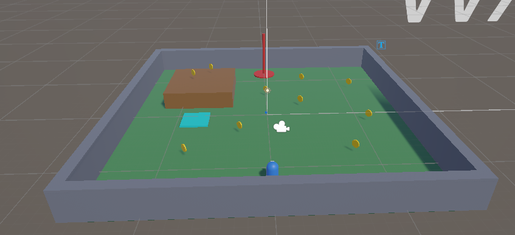
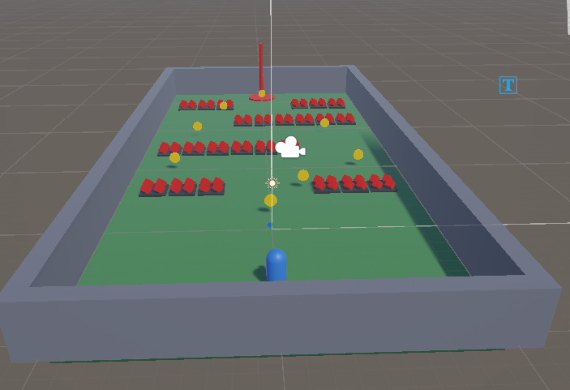
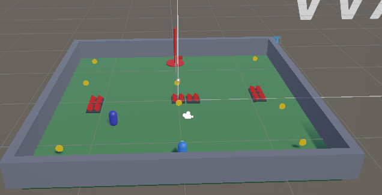
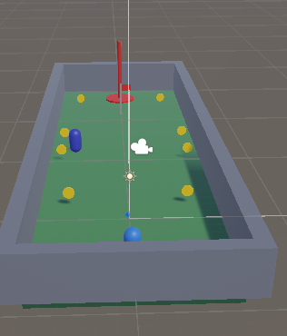
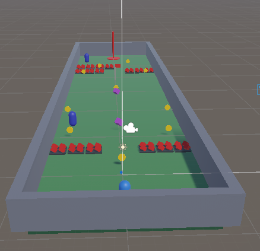

# CS464 Assignment 03 · [Your name] · [Roll no]

- **Video (60–120 s):** [YouTube (unlisted) or Google Drive link]
- **Started from:** [your Assignment 02 repo's link, or "a new project", and why]
- **Controls:** WASD / arrow keys move, SPACE jump, R restart the level, N skip to next level (testing)
- **To win a level:** collect the required coins (shown as Score x / y on screen), then step on the goal. It turns from red to green when it is open.

## Levels

| Level | Screenshot | New idea | Combined with |
|---|---|---|---|
| Level01 |  | Coins, a score, a goal, and a bounce pad (VelocityChange) | Nothing hurts yet |
| Level02 |  | Spikes that cost one heart at a time, with i-frames and knockback | Coins next to the spikes (risky detours) |
| Level03 |  | A guard that patrols, chases, gives up and returns | Spikes beside its route, a checkpoint |
| Level04 |  | The crusher: rest, yellow warning, then a 2-damage strike | A ping-pong guard between the crushers |
| Level05 |  | Two speed power-ups (second pickup refreshes the timer) | Everything so far, plus a second guard |

## The numbers

| Number | Value | Why this value |
|---|---|---|
| Patrol speed | 2 m/s (2.5 for the ping-pong guard in Level05) | [check in play: a third of the player's 6 m/s run speed, so you can read the route] |
| Chase range | 6 m start chasing, 9 m give up | [check in play: give-up is longer than chase range so the guard can't flicker at one edge] |
| Knockback | 9–12, ForceMode.Impulse, steering off 0.25 s | [measure in play: how far it throws you] |
| I-frames | 1 s (2 s after a respawn) | [e.g. long enough to get clear of a spike tile] |
| Power-up duration | 5 s, x1.6 speed | [e.g. long enough to cross a section, not the whole level] |
| Chase speed | 3.5 m/s | [slower than the player, so you can always outrun it] |
| Crusher warning | 0.8 s | [more than 0.5 s so you can react] |

## Short answers

**1. Why does a trigger need a Rigidbody on at least one of the two objects?**
[write this in your own words, about your own code]

**2. Which ForceMode do your knockback and your Part A force use, and why each?**
[write this in your own words, about your own code]

**3. What does your code do when a second power-up is picked up while one is running?**
[write this in your own words, about your own code]

**4. Why can `==` fail as an arrival check, and when does it work?**
[write this in your own words, about your own code]
